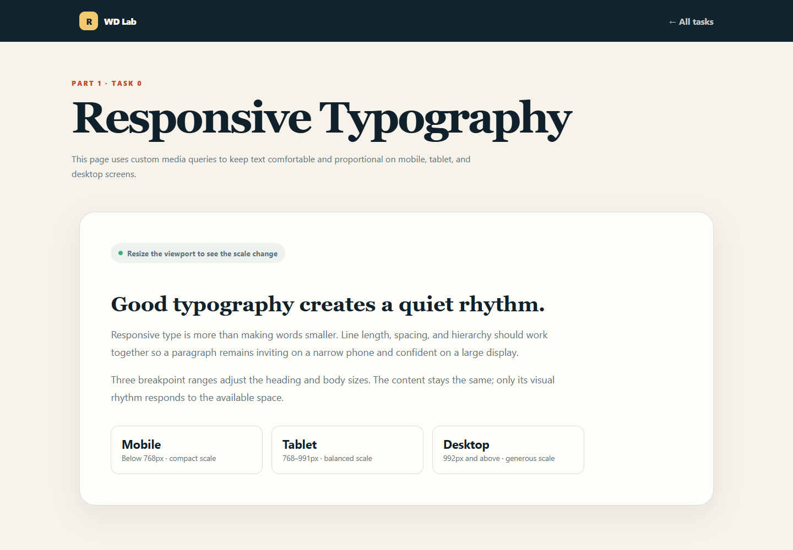
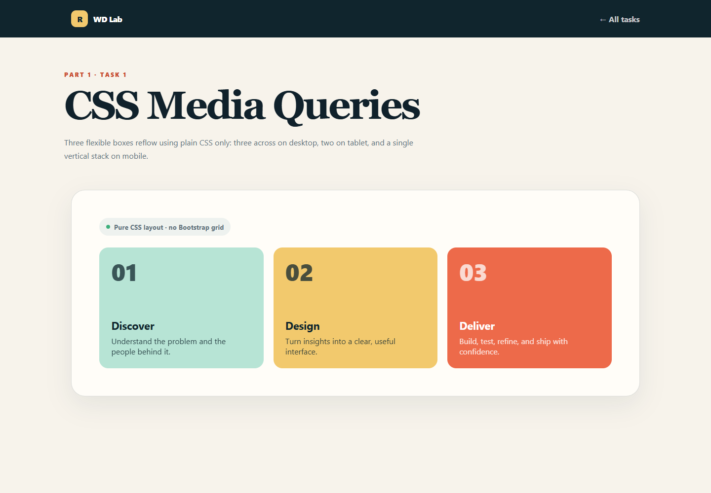
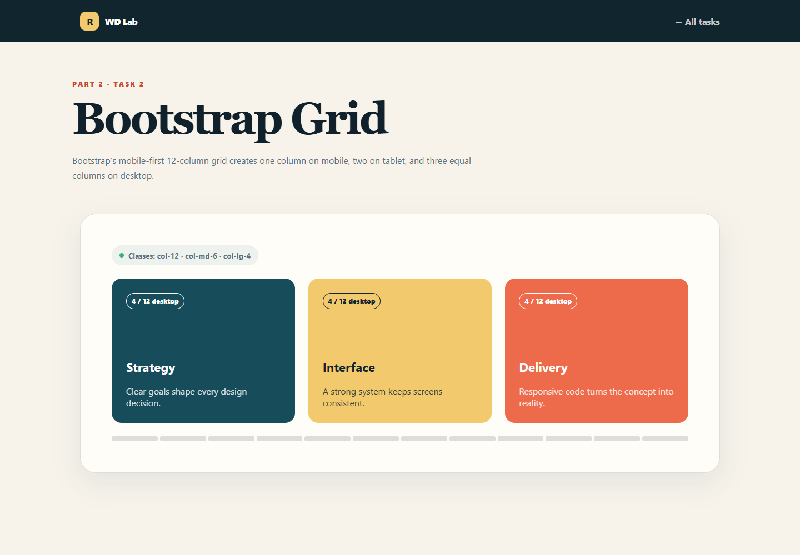
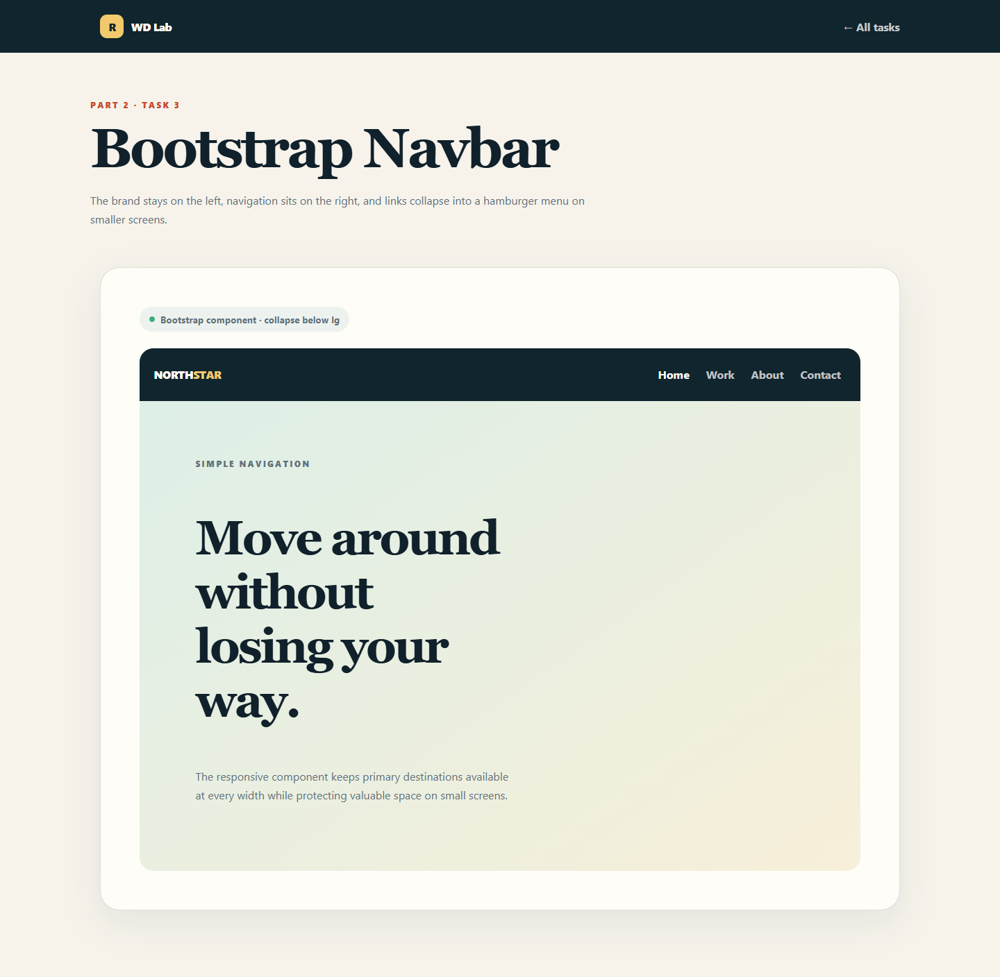
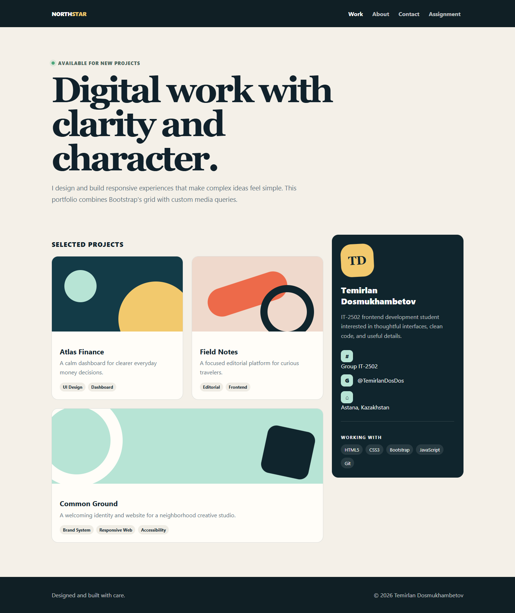

# Assignment 3 — Responsive Web Design

**Student:** Temirlan Dosmukhambetov  
**Group:** IT-2502

A five-part frontend assignment demonstrating responsive typography, CSS media queries, Bootstrap's 12-column grid, a collapsible Bootstrap navbar, and a complete responsive portfolio page.

## Live project

Open `index.html` in a browser or serve the project with any static server.

## Part 1 — Media Queries

### Task 0 — Responsive Typography

The typography page uses custom CSS breakpoints to provide compact mobile type, a balanced tablet scale, and generous desktop typography.



### Task 1 — Responsive Layout with Media Queries

Three boxes are displayed in one row on desktop, two per row on tablet, and stacked vertically on mobile. This layout is implemented with plain CSS media queries and does not use the Bootstrap grid.



## Part 2 — Bootstrap Grid System

### Task 2 — Bootstrap Responsive Columns

The layout uses `col-12 col-md-6 col-lg-4`: one column on mobile, two columns on tablet, and three equal four-column sections on desktop.



### Task 3 — Bootstrap Navigation Bar

The navbar keeps the logo on the left and navigation links on the right. Below the large breakpoint, the links collapse into Bootstrap's accessible hamburger menu.



## Part 3 — Combined Project

### Task 4 — Responsive Portfolio Page

The final portfolio combines a Bootstrap navbar, a responsive card grid, a personal information sidebar, a full-width footer, and custom media queries for typography, spacing, and element visibility.



## Work process

1. Planned three viewport ranges: mobile, tablet, and desktop.
2. Built semantic HTML for every task with accessible labels and heading order.
3. Added a shared visual system with CSS variables, consistent spacing, and reusable components.
4. Implemented Tasks 0 and 1 with custom media queries.
5. Implemented Tasks 2–4 with Bootstrap 5.3 grid and navigation components.
6. Tested layouts at desktop, tablet, and mobile widths and checked navigation behavior.

## Technologies

- HTML5
- CSS3 and Media Queries
- Bootstrap 5.3
- JavaScript
- Git and GitHub

## Project structure

```text
.
├── index.html
├── css/styles.css
├── js/main.js
├── pages/
│   ├── task0.html
│   ├── task1.html
│   ├── task2.html
│   ├── task3.html
│   └── task4.html
└── screenshots/
```
